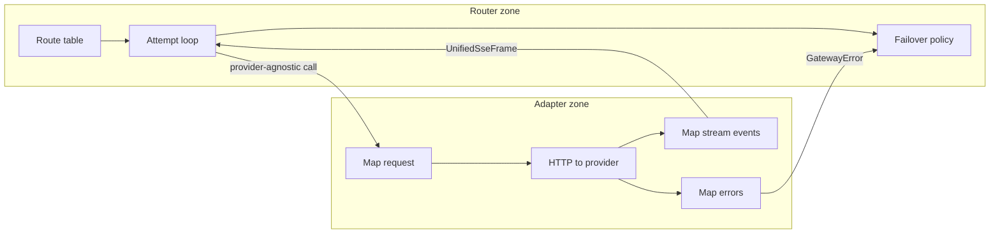

# Provider adapter pattern

## Why

Provider wire formats change independently of routing policy. The adapter boundary keeps **failover/routing** stable when onboarding Anthropic, OpenAI, or later providers.

## Interface (conceptual)

```text
Adapter
  id: provider name
  stream(ctx, unifiedRequest, upstreamModel, credentials, signal) -> AsyncIterable<UnifiedSseFrame>
  complete(ctx, unifiedRequest, upstreamModel, credentials, signal) -> UnifiedCompletion
  // errors: throw typed GatewayError { class, httpStatus?, retryable/failoverEligible }
```

`ctx` carries request id, timeout budget for this attempt, and metrics labels.

### Error classes adapters must emit

| Class | Failover eligible (pre-stream) | Typical sources |
|---|---|---|
| `client_error` | No | 400-class after mapping; invalid upstream response that indicates bad request |
| `rate_limited` | Yes | 429 |
| `upstream_unavailable` | Yes | 5xx, connection reset, DNS/TLS failure |
| `timeout` | Yes if pre-stream; mid-stream → hard fail | Connect / TTFB / idle / overall |
| `upstream_fatal` | No | Unrecoverable mid-stream protocol break after open |

## Responsibilities split



Router **must not** import Anthropic/OpenAI SDKs or branch on event names like `content_block_delta` vs `chat.completion.chunk`.

## First adapters (planned)

1. **Anthropic** — Messages API + SSE; map `messages` / system split as required.
2. **OpenAI** — Chat Completions API + SSE; near-passthrough of unified schema with model id swap.

Order of preference for a logical model is **route config**, not adapter code (example: Anthropic then OpenAI).

## Cancel / abort

Every adapter must pass the attempt `AbortSignal` (or equivalent) into the upstream HTTP client so client disconnect and timeout cancellation actually stop the provider call.
