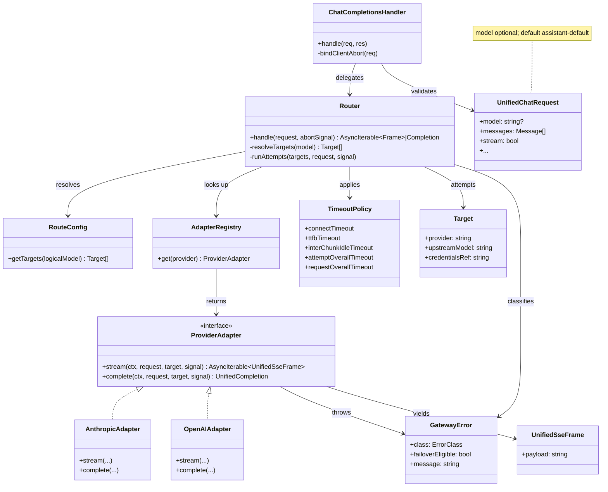
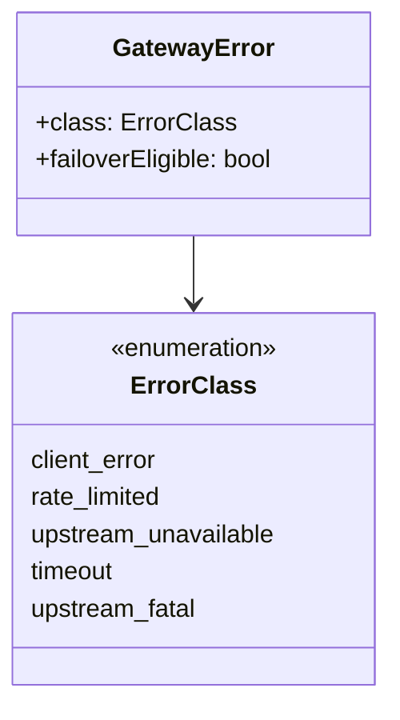

# Class diagrams (conceptual)

Structural view after [high-level](high-level.md) and [request flows](request-flows.md). These are **design-time** shapes — names may shift slightly when we pick a stack, but the boundaries should not.

## Core types



## Responsibility boundaries

| Type | May know | Must not know |
|---|---|---|
| `ChatCompletionsHandler` | HTTP, SSE headers, validation | Provider URLs, failover ordering details beyond calling Router |
| `Router` | Targets, attempt loop, failover eligibility, timeouts | Anthropic/OpenAI event names or auth headers |
| `ProviderAdapter` | One provider’s wire protocol | Other providers; global route table |
| `RouteConfig` | Model → target list | How to call HTTP |
| `TimeoutPolicy` | Duration budgets | Provider-specific APIs |

## Error classification (shared vocabulary)



Router uses `failoverEligible` **and** “has the client stream locked?” to decide the next action (see flows).

## Suggested package sketch (when code exists)

```text
gateway/
  http/          ChatCompletionsHandler
  router/        Router, TimeoutPolicy, GatewayError
  config/        RouteConfig, Target
  adapters/      ProviderAdapter, AdapterRegistry
    anthropic/
    openai/
  types/         UnifiedChatRequest, UnifiedSseFrame, ...
```

## Next / deeper

- Adapter method contracts: [adapters.md](adapters.md)
- Failover matrix: [routing-and-failover.md](routing-and-failover.md)
- Test doubles against these boundaries: [testing.md](testing.md)
