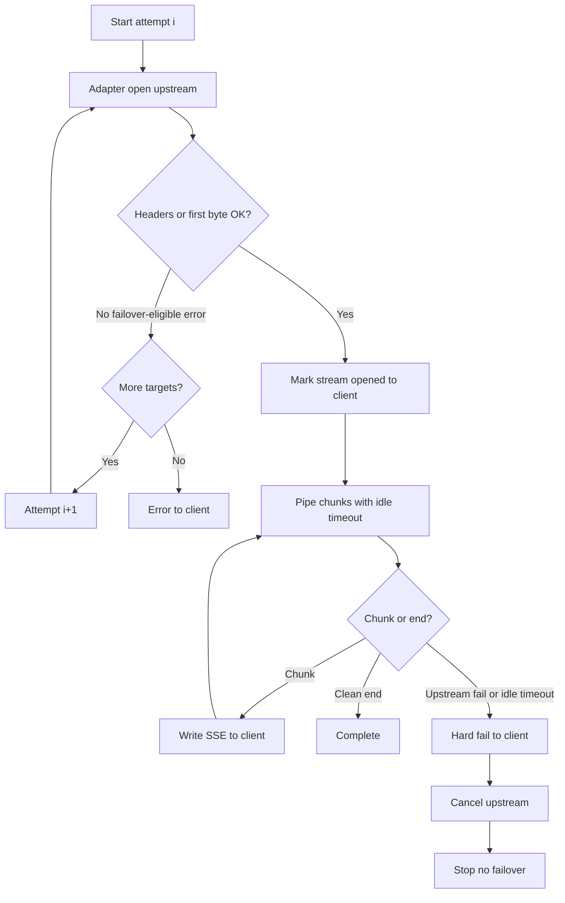

# Architecture overview

This document describes the request pathway for `POST /v1/chat/completions`: how routing, adapters, and stream piping interact. Detailed rules live in sibling docs.

## Components

| Component | Responsibility |
|---|---|
| **HTTP handler** | Validate unified request; open client response (JSON or SSE); attach abort on client disconnect |
| **Router** | Resolve `model` → ordered targets; run attempt loop; enforce pre-stream failover vs mid-stream hard fail |
| **Adapter registry** | Map `provider` id → adapter implementation |
| **Provider adapter** | Wire-format translate; call upstream; normalize chunks/errors; honor abort |
| **Timeout policy** | Connect, TTFB, inter-chunk idle, overall ceilings |
| **Route config** | Logical model → `[{ provider, upstreamModel, credentialsRef }, …]` |

## Request path (happy stream)

```mermaid
sequenceDiagram
  participant C as Client
  participant H as HTTPHandler
  participant R as Router
  participant A as Adapter
  participant U as UpstreamLLM

  C->>H: POST /v1/chat/completions stream=true
  H->>H: Validate unified schema
  H->>R: route(request, abortSignal)
  R->>R: Resolve ordered targets
  R->>A: stream(attempt, abortSignal)
  A->>U: Provider-native streaming request
  U-->>A: Chunk N
  A-->>R: Unified SSE frame
  R-->>H: Pipe frame
  H-->>C: SSE data line
  Note over R,H: No full-body buffer; frame-sized memory only
  U-->>A: Done
  A-->>R: End
  H-->>C: [DONE] / close
```

## Attempt loop (failover boundary)



## Trust / isolation boundaries

- **Client-facing:** unified OpenAI-style schema only.
- **Router:** provider-agnostic; only sees adapter results and error classes.
- **Adapter:** only place that knows Anthropic vs OpenAI URLs, headers, and stream codecs.
- **Secrets:** credentials resolved by `credentialsRef` inside adapter (or a small credentials helper used by adapters) — not logged.

## Sibling docs

- [Streaming & memory](streaming.md)
- [Adapters](adapters.md)
- [Routing & failover](routing-and-failover.md)
- [NFRs](../non-functional-requirements.md)
