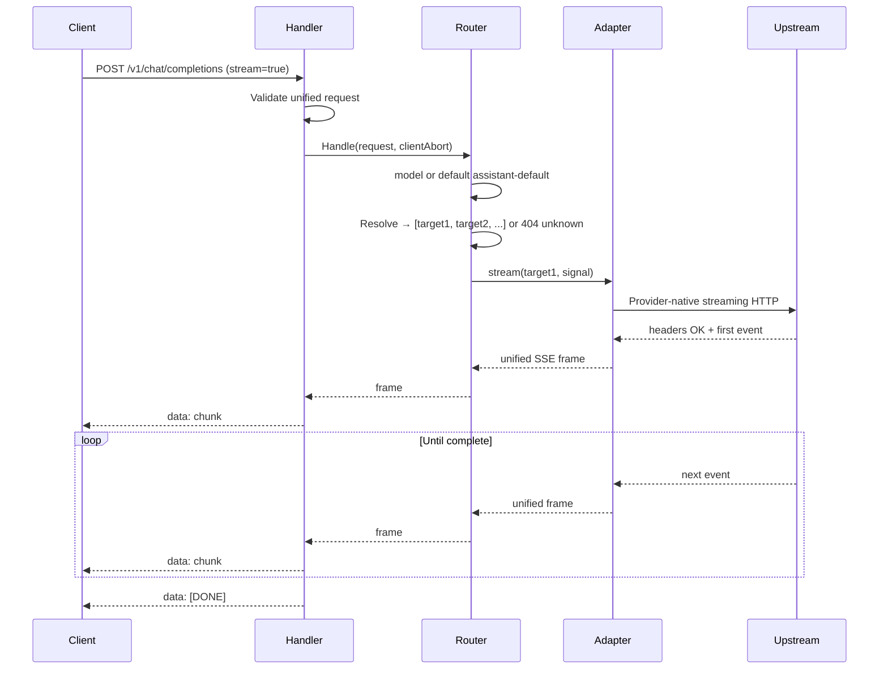
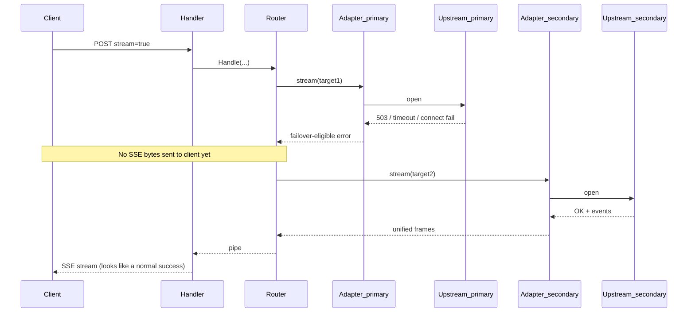
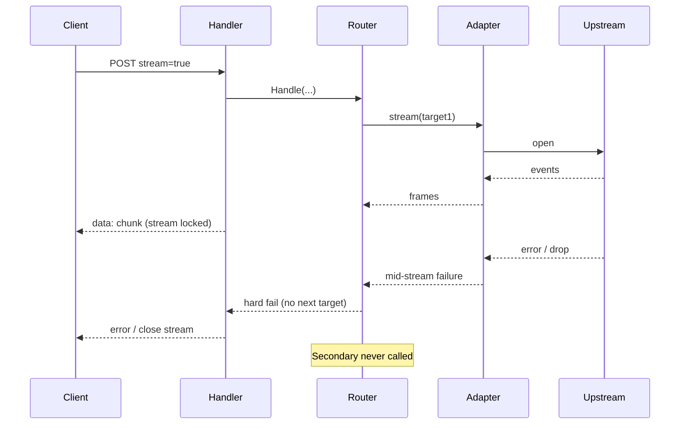
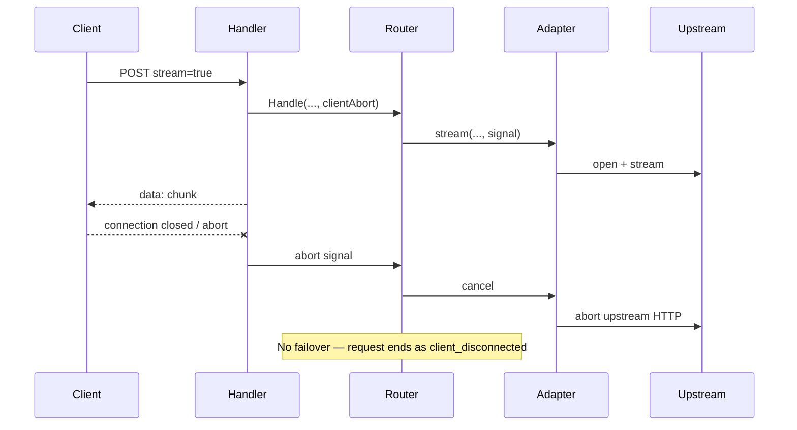
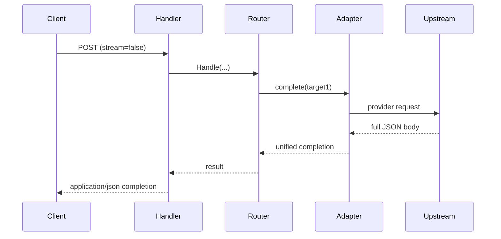
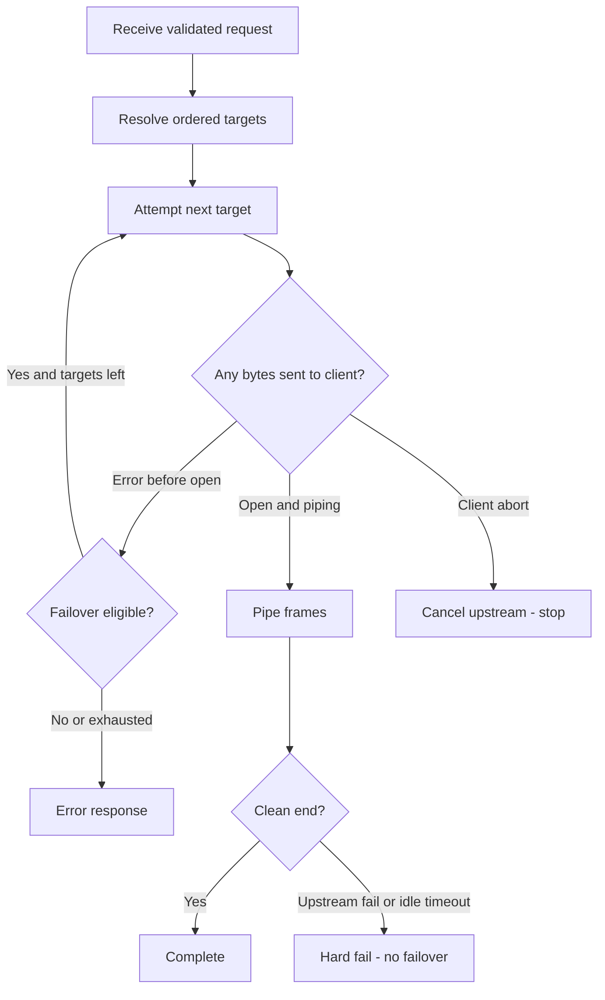

# Request flows & sequences

End-to-end behavior after the [10,000 ft view](high-level.md). This page is the **movie** of a request — not class internals.

## Actors

| Actor | Role |
|---|---|
| Client | App/SDK calling the gateway |
| Handler | HTTP edge: validate, open response, wire abort |
| Router | Target list + attempt/failover loop |
| Adapter | Provider-specific translate + upstream I/O |
| Upstream | Real LLM API |

---

## Flow 1 — Happy path (streaming)

**Memory note:** each loop iteration carries one frame; the gateway does not assemble the full assistant text for streaming.

---

## Flow 2 — Pre-stream failover (silent)

Primary fails before any chunk reaches the client; secondary serves the stream.

---

## Flow 3 — Mid-stream hard failure

Tokens already started; upstream dies. No switch to another provider.

---

## Flow 4 — Client disconnect mid-generation

---

## Flow 5 — Non-stream completion

Pre-stream failover rules still apply if `complete()` fails before a successful body is accepted; there is no partial SSE lock, but once a final JSON success is chosen, the client gets that single response.

---

## Flow 6 — Attempt loop (control view)

---

## Next

→ [Class diagrams](class-diagrams.md)

Deeper policy detail: [routing-and-failover.md](routing-and-failover.md) · [streaming.md](streaming.md)
