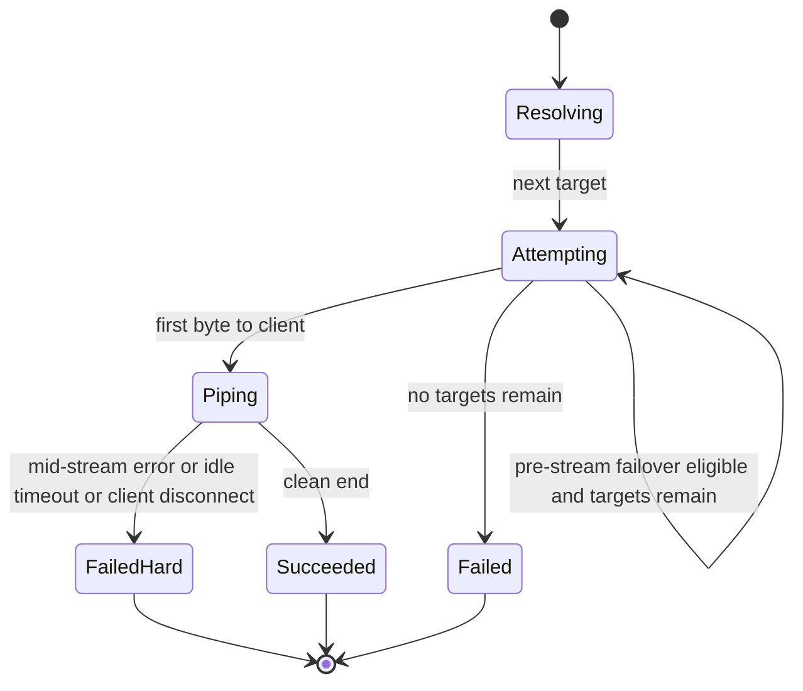

# Routing & failover

## Route resolution

At request time:

1. Read logical `model` from the unified body.
   - If **missing / null / empty** → use default **`assistant-default`**.
2. Look up that name in route config.
   - If **not found** → **404** `model_not_found` (4xx client error); no upstream calls, no failover.
3. Otherwise load the ordered target list:
   `{ provider, upstreamModel, credentialsRef }[]`
   - `targets[0]` = primary, `targets[1]` = first fallback, and so on.
4. Cap list length by `max_targets` (NFR default: 3).
5. For each target in order, run one **attempt** via the adapter registry.

Example (illustrative):

```yaml
defaultModel: assistant-default
models:
  assistant-default:
    targets:
      - provider: anthropic          # primary
        upstreamModel: claude-sonnet-4-20250514
        credentialsRef: anthropic_default
      - provider: openai             # fallback if Anthropic fails pre-stream
        upstreamModel: gpt-4o
        credentialsRef: openai_default
      # - provider: other            # further fallbacks as configured
```

Caller sends the **logical** name they want (or omits it for the default). They do **not** pick Anthropic vs OpenAI on the wire — that order is config.

## Attempt lifecycle



## Failover eligibility matrix

| Situation | Action |
|---|---|
| Validation / client 4xx before upstream | Return error; no attempt loop |
| Unknown logical `model` | **404** `model_not_found`; no attempt loop |
| Pre-stream: 429, 5xx, connect fail, TTFB timeout | Next target (silent) |
| Pre-stream: client_error from adapter | Return to client; no next target |
| First unified frame written | **Lock** provider for this request |
| Mid-stream upstream failure | Hard fail; no next target |
| Client disconnect | Abort upstream; stop; no next target |
| Max targets exhausted | Final error to client |

“Silent” means the client protocol does not require a failover notice. Internal logs/metrics **should** record `target_index`, `provider`, and reason.

## Interaction with timeouts

- Connect + TTFB timeouts occur **before** lock → failover-eligible.
- Inter-chunk idle and mid-stream overall expiry occur **after** lock → hard fail.
- See [NFRs §3.3](../non-functional-requirements.md#33-timeout-strategy-targeted).
