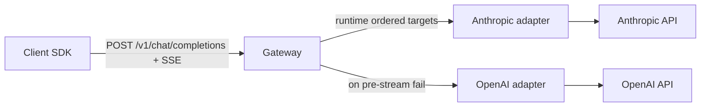

# Unified LLM Gateway — Problem & Functional Requirements

## Problem statement

Applications need one stable way to request streamed chat inference without owning provider-specific APIs, SDKs, routing, or failover. Each upstream LLM (Anthropic, OpenAI, etc.) differs in URL, auth, request body, stream framing, and errors. The gateway sits in the middle: **one client contract in, many providers out**, so onboarding a new upstream does not change client code.

This is infrastructure (protocol unification + routing + stream proxy + resilient failover), not a chatbot UI, model host, or billing marketplace.

## Locked product rules

- **Ingress API:** modern OpenAI-style `POST /v1/chat/completions` (messages-based). Not legacy `/v1/completions`.
- **Adaptation boundary:** client always speaks the unified schema; **adapters translate on egress** to each upstream and normalize streams/errors back.
- **Routing:** runtime strategy resolves a logical model/route to an **ordered target list** (example policy: Anthropic first, OpenAI second). Order comes from configuration, not hardcoded handler logic.
- **Streaming:** SSE proxy — pipe chunks through; do not buffer the full completion in memory.
- **Failover:** on upstream failure classes (429, 5xx, timeouts, connection errors), try the next target **only before any SSE chunk has been sent to the client**.
- **Mid-stream failure:** **hard failure** to the client (end/error the stream). No silent provider switch after first byte.
- **Do not failover** on clear client errors (e.g. 400 invalid request).

## Functional requirements (MVP)

1. **Unified chat completions endpoint** — accept a standard chat-completions request; return either a normal JSON completion or an SSE token stream in the unified shape.
2. **Provider adapter interface** — each upstream implements: map request → upstream wire format; open upstream stream/request; map upstream chunks → unified SSE; map upstream errors → gateway error classes.
3. **Dynamic route resolution** — given `model` (and later any route metadata), load an ordered list of targets `{ provider, upstreamModel, credentialsRef }` at request time.
4. **Streaming proxy** — when `stream: true`, forward chunks as they arrive; gateway memory stays bounded to chunk/buffer size, not full response size.
5. **Pre-stream silent fallback** — if the primary target fails before the first client chunk, attempt the next target with the same logical request; client is not told which upstream served (logging/metrics may record it).
6. **Mid-stream hard failure** — if the active upstream fails after streaming started, terminate the client stream with an error; do not start another provider for that request.
7. **Provider onboarding without client changes** — adding a provider means new adapter + route config only.

## Explicit non-goals (for now)

- End-user chat UI, auth product, usage billing, or public model marketplace
- Mid-stream cross-provider resume or seamless splice of two model outputs
- Training, fine-tuning, or hosting models
- Full parity of every provider-specific feature (tools/vision/etc.) beyond what the first adapters cleanly map

## Out of scope until next pass

**Non-functional requirements** (latency budgets, timeouts, concurrency, observability, config/reload, secrets handling, deployment shape, SLOs) — see [non-functional-requirements.md](non-functional-requirements.md).

## Suggested sequence after this doc

1. Agree NFRs (timeouts, retry bounds, max fallback depth, logging, config format, target stack).
2. Produce architecture documents under [`architecture/`](architecture/).
3. Implement against those docs (scaffold, adapters, route table, streaming path, failure-matrix tests).
